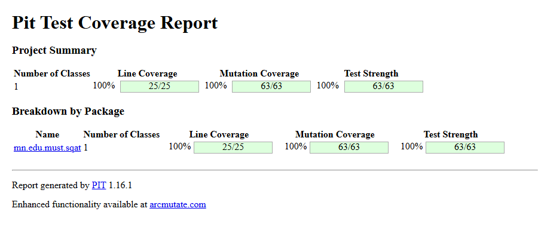

# Лаборатори №11: Mutation testing — PIT-ээр тестийн чанараа хэмжих

**Оюутан:** Х.Түмэн-Амгалан
**Код:** B232270063
**Хичээл:** F.CSA313 — Программ хангамжийн чанарын баталгаа ба тест (2026)

## Орчин

```
$ java -version
openjdk version "17.0.20.1" 2026-08-18
OpenJDK Runtime Environment Temurin-17.0.20.1+1 (build 17.0.20.1+1)
OpenJDK 64-Bit Server VM Temurin-17.0.20.1+1 (build 17.0.20.1+1, mixed mode, sharing)

$ mvn -version
Apache Maven 3.9.9 (8e8579a9e76f7d015ee5ec7bfcdc97d260186937)
Maven home: C:\Users\tumee\tools\apache-maven-3.9.9
Java version: 17.0.20.1, vendor: Eclipse Adoptium, runtime: C:\Program Files\Eclipse Adoptium\jdk-17.0.20.101-hotspot
Default locale: en_US, platform encoding: Cp1252
OS name: "windows 11", version: "10.0", arch: "amd64", family: "windows"
```

> Эх сурвалж: [`results/versions.txt`](results/versions.txt). PIT 1.16.1 (`STRONGER` операторууд),
> JaCoCo 0.8.12 — starter-ийн `pom.xml`. `src/main` нь лабын турш **өөрчлөгдөөгүй** (Starter commit-той
> ижил) — зөвхөн тестийг өөрчилсөн. `results/` дахь файлууд Git Bash-ийн `tee`-ээр UTF-8 текст.

## Mutation score-ийн явц

| Хэмжилт | Тест | `>> Generated … Killed …` | Mutation Coverage | Test Strength | Файл |
|---|---:|---|---:|---:|---|
| Эхлэл (starter) | 6 | `Generated 63 mutations Killed 17 (27%)` | **27%** | 27% | [`results/pit-start.txt`](results/pit-start.txt) |
| B1 — яг утгын assertion | 6 | `Generated 63 mutations Killed 45 (71%)` | **71%** | 71% | [`results/pit-B1.txt`](results/pit-B1.txt) |
| B2 — зааг утгын тест (эцсийн) | 14 | `Generated 63 mutations Killed 63 (100%)` | **100%** | 100% | [`results/pit-B2.txt`](results/pit-B2.txt) |

Line Coverage гурвуулаа **25/25 (100%)**, "Mutations with no coverage 0" — өөрөөр хэлбэл кодын мөр
бүр эхнээсээ ажиллаж байсан, өссөн нь зөвхөн тестийн **шалгах чадвар**.

---

## Эхний хэмжилт

```bash
mvn clean verify 2>&1 | tee results/mvn-verify-start.txt
cp target/site/jacoco/jacoco.csv results/jacoco-start.csv
mvn test-compile org.pitest:pitest-maven:mutationCoverage 2>&1 | tee results/pit-start.txt
```

**JaCoCo:** `results/jacoco-start.csv` — `LINE_MISSED 0, LINE_COVERED 25` → **Line 100% (25/25)**,
`BRANCH_MISSED 3, BRANCH_COVERED 38` → **Branch 38/41**.


**PIT:** `>> Generated 63 mutations Killed 17 (27%)`.


**Ажиглалт:** Line Coverage 100% байхад Mutation Coverage ердөө 27% байсан нь тестүүд кодын бүх мөрийг
**ажиллуулдаг** ч гаралтыг бараг **шалгадаггүй**-г хэлж байна. `assertNotNull(letterGrade(95))`,
`assertTrue(0 <= gpa <= 4)` гэх мэт assertion нь "A"-ийн оронд "" эсвэл 3.5-ийн оронд 0.0 буцаасан
буруу кодыг ч зөв гэж хүлээн авдаг тул 63 мутантын 46 нь амьд үлдсэн. Хамралт нь "код ажилласан уу"
гэдгийг, mutation score нь "буруу код байвал тест мэдэх үү" гэдгийг хэмждэг.

---

## Хэсэг A: Амьд мутантуудын ангилал (эхлэл дээр 46)

PIT-ийн XML тайлангаас (`mutations.xml`) мутант бүрийн мөр, оператор, тайлбарыг гаргаж, B1 болон B2-ийн
дараах тайлантай мутант мутантаар нь тулгасан. Ижил шалтгаантайг нэг мөрөнд нэгтгэв.

| Мөр | Мутаци (PIT-ийн тайлбар) | Тоо | Ангилал | Арга хэмжээ (алсан алхам) |
|---|---|---:|---|---|
| 20 | changed conditional boundary (`score < 0` → `<= 0`, `score > 100` → `>= 100`) | 2 | Тест дутуу | **B2**: `letterGrade(0)="F"`, `letterGrade(100)="A"` — заагийн яг утга |
| 23–26 | changed conditional boundary (`>= 90/80/70/60` → `>`) | 4 | Тест дутуу | **B2**: 90, 80, 70, 60 дээрх яг утга |
| 23–27 | replaced return value with "" (`letterGrade`) | 5 | Тест дутуу | **B1**: `assertNotNull` → `assertEquals("A"…"F")` |
| 23–26 | removed conditional — replaced comparison check with false / true | 8 | Тест дутуу | **B1**: яг үсгэн дүнг шалгахад салаа солигдсон нь илэрнэ |
| 36 | Changed switch default to be first case | 1 | Тест дутуу | **B1**: `gpa([40]) == 0.0` — F дүнгийн оноог яг шалгана |
| 38, 40 | Replaced double addition with subtraction (`total += 3`, `total += 1`) | 2 | Тест дутуу | **B1**: `gpa([95,85]) == 3.5`, `gpa([75,65]) == 1.5` |
| 44 | replaced double return with 0.0d (`gpa`) | 1 | Тест дутуу | **B1**: муж биш яг голч |
| 48 | changed conditional boundary (`gpa < 0`, `gpa > 4`) | 2 | Тест дутуу | **B2**: `scholarship(0.0, 0)`, `scholarship(4.0, 15)` хүчинтэй |
| 48 | removed conditional — replaced comparison check with true | 1 | Тест дутуу | **B2**: оролтын хязгаарын тест (gpa 0 / 4, credits 0) |
| 51 | removed conditional — replaced equality check with false / true (`hasViolation`) | 2 | Тест дутуу | **B1**: `scholarship(4.0, 20, true) == 0` ба зөрчилгүй тохиолдлын яг утга |
| 52–54 | replaced int return with 0 (`return 100/70/50`) | 3 | Тест дутуу | **B1**: `assertTrue(0..100)` → яг 100 / 70 / 50 |
| 52, 53 | removed conditional — replaced comparison check with false | 4 | Тест дутуу | **B1**: салаа алгасвал буцаах хувь өөрчлөгдөнө — яг утга шалгана |
| 52, 53 | changed conditional boundary (`>= 3.8`, `>= 15`, `>= 3.4`, `>= 12`) | 4 | Тест дутуу | **B2**: 3.8/15, 3.4/12 дээрх яг утга |
| 52, 53 | removed conditional — replaced comparison check with true (`&&`-ийн нэг тал) | 4 | Тест дутуу | **B2**: нэг тал хангагдаж нөгөө нь үгүй — (3.79,15), (3.8,14), (3.39,12), (3.4,11) |
| 54 | changed conditional boundary (`>= 3.0`) | 1 | Тест дутуу | **B2**: `scholarship(3.0,0)=50`, `(2.99,0)=0` |
| 54 | removed conditional — replaced comparison check with false / true | 2 | Тест дутуу | **B1**: 3.1 → 50 ба 2.0 → 0-ийг яг шалгана |
| | **Нийт** | **46** | **46 тест дутуу, 0 equivalent** | B1 — 28, B2 — 18 |

**Ангиллын үндэслэл:**
- **"changed conditional boundary"** (13): `>=`-ийг `>` болгох нь зөвхөн заагийн яг утга (90, 60, 3.8, 15 г.м.)
  дээр зан төлөвийг өөрчилдөг тул **тест дутуу** — starter-т заагийн утга нэг ч байгаагүй.
- **"replaced return value" / "replaced … with 0" / "addition with subtraction"** (11): гаралтын утгыг өөрчилдөг
  тул бодит зан төлөв өөрчлөгдөнө — **тест дутуу** (assertion сул байсан).
- **"Changed switch default to be first case"** (1): F дүнгийн оноог өөрчилдөг тул **тест дутуу** (доор).
- **"removed conditional"** (21): салааг үргэлж/хэзээ ч авахгүй болгох нь өөр үр дүн буцаадаг тул **тест дутуу**;
  `&&`-ийн нэг талыг "true" болгосон 4 мутант зөвхөн тэр тал **худал**, нөгөө нь **үнэн** үед ялгардаг.
- **Equivalent: 0.** L36-ийн `switch` мутантыг эхэндээ equivalent байж магадгүй гэж сэжиглэсэн (String `switch`
  нь hash-аар хоёр шатлан хөрвүүлэгддэг), гэвч B1-ийн `gpa([40]) == 0.0` түүнийг алсан — зааврын
  «Equivalent гэж ангилахдаа болгоомжтой — ихэнх нь үнэндээ тест дутуу» гэдэг энд батлагдсан.

---

## Хэсэг B: Тестүүдээ хүчтэй болгох

### B1 — Assertion-уудыг хүчтэй болгох

Starter-ийн **оролтуудыг хэвээр нь** үлдээж, сул шалгалтыг яг утгаар солив:

| Өмнө | Дараа |
|---|---|
| `assertNotNull(calc.letterGrade(95))` | `assertEquals("A", calc.letterGrade(95))` (85→B, 75→C, 65→D, 30→F) |
| `assertTrue(g1 >= 0 && g1 <= 4)` | `assertEquals(3.5, calc.gpa({95,85}))`, `1.5` (75,65), `0.0` (40) |
| `assertTrue(s1 >= 0 && s1 <= 100)` | `assertEquals(100/70/50/0/0, …)` |

`results/pit-B1.txt`: **`Generated 63 mutations Killed 45 (71%)`** — 28 мутант нэмж алагдсан.

### B2 — Зааг утгын тестүүд

| Тест | Шалгах заагууд |
|---|---|
| `letterGrade_boundaries_eachSideOfEveryLimit` | 100, 90/89.99, 80/79.99, 70/69.99, 60/59.99, 0 |
| `letterGrade_justOutsideRange_throws` | −0.01, 100.01 |
| `gpa_eachLetterGrade_mapsToExactPoints` | A/B/C/D/F тус бүр (4/3/2/1/0) + бүгд хамт = 2.0 |
| `scholarship_boundary_3_8_and_15` | (3.8,15)=100, (3.79,15)=70, (3.8,14)=70 |
| `scholarship_boundary_3_4_and_12` | (3.4,12)=70, (3.39,12)=50, (3.4,11)=50 |
| `scholarship_boundary_3_0` | (3.0,0)=50, (2.99,0)=0 |
| `scholarship_inputLimits_areValid` | gpa 0, credits 0 → 0; gpa 4 → 100 |
| `scholarship_justOutsideInputLimits_throws` | gpa −0.01, 4.01, credits −1 |

`results/pit-B2.txt`: **`Generated 63 mutations Killed 63 (100%)`**, `Test strength 100%` — зорилт (≥ 85%) давсан;
амьд мутант үлдээгүй тул equivalent-аар хасах шаардлагагүй.



---

## Хэсэг C: Гараар нэг мутант — PIT-гүйгээр

### Гар мутаци: `gpa >= 3.8` → `gpa > 3.8` (52-р мөр)

```bash
mvn test 2>&1 | tee results/mvn-test-manual-mutant.txt
```

```
[ERROR] mn.edu.must.sqat.ScholarshipCalculatorTest.scholarship_boundary_3_8_and_15 <<< FAILURE!
org.opentest4j.AssertionFailedError: expected: <100> but was: <70>
[ERROR] Tests run: 14, Failures: 1, Errors: 0, Skipped: 0
[INFO] BUILD FAILURE
```

B2-ийн `scholarship(3.8, 15, false) == 100` тест мутантыг барьсан: голч яг 3.8 үед мутант 100%-ийн
салаанд орохгүй 70% буцаасан. Starter-ийн `assertTrue(s1 >= 0 && s1 <= 100)` үүнийг хэзээ ч барихгүй
байсан. Дараа нь кодыг эх хувилбараар нь буцаасан (мутацийг commit хийгээгүй).

### Өөрийн зохиосон EQUIVALENT мутант: `score >= 90` → `score >= 90 && score <= 100` (23-р мөр)

```
[INFO] Tests run: 14, Failures: 0, Errors: 0, Skipped: 0
[INFO] BUILD SUCCESS
```

> Эх сурвалж: [`results/mvn-test-equivalent-mutant.txt`](results/mvn-test-equivalent-mutant.txt)

20-р мөр 100-аас их онооны үед аль хэдийн exception шиддэг тул 23-р мөрд хүрсэн аливаа `score` заавал
`<= 100` бөгөөд нэмсэн нөхцөл үргэлж үнэн — програмын зан төлөв ямар ч оролтод өөрчлөгддөггүй. Иймд
ямар ч тест (эсвэл PIT) энэ мутантыг "алж" чадахгүй: ялгаатай гаралт гаргах оролт **оршихгүй**.

---

## Дүгнэлт

Хамралт ба mutation score өөр асуултад хариулдаг: JaCoCo-гийн Line 100% нь кодын мөр бүр тестийн
явцад **ажилласныг** л хэлдэг бол mutation score нь кодыг зориуд эвдэхэд тест **унаж чадах эсэхийг**
хэмждэг — энэ лабд Line 100% хэвээр байхад mutation score 27% → 71% → 100% болж өссөн. Starter-ийн
багц JaCoCo-д "төгс" харагдаж байсан ч 46 мутантыг амьд үлдээсэн нь хамралт тестийн чанарын
**доод хязгаар** болохоос нотолгоо биш гэдгийг харуулав. Алдааны хоёр төрөл тодорхой ялгарсан:
сул assertion (B1 — 28 мутант) ба зааг утгын тест дутуу (B2 — 18 мутант), тус бүрийг өөр арга
засдаг. Equivalent мутантыг ялгах нь хамгийн болгоомжтой хандах хэсэг байлаа — сэжигтэй харагдсан
`switch` мутант үнэндээ тест дутуу байсан. AI-аар тест бичүүлэхэд энэ нь онцгой чухал: AI нь кодыг
"бүрэн хамарсан" олон тест хурдан бичдэг ч `assertNotNull`, `assertTrue(муж)` шиг сул эсвэл заагийн
утгагүй тест бичих магадлалтай тул хамралт 100% харагдаж болно; mutation score нь тэр тестүүд
бодитоор алдаа барьж чадах эсэхийг объектив, автоматаар шалгадаг цорын ганц хэмжүүр юм.

---

## AI туслахын хэрэглээ

Энэ лабд **Claude Code (AI туслах)**-ыг ашигласан: B1/B2 тестүүдийг бичих, PIT-ийн XML тайлангаас
амьд мутант бүрийг алхам бүрийн тайлантай тулгаж ангилах, JaCoCo/PIT-ийн HTML тайлангийн дэлгэцийн
зургийг (Playwright) авах, README-ийн текстийг бичихэд. Бүх тестийг өөрийн машин дээр ажиллуулж, бүх
тоог `results/pit-*.txt` ба бусад гаралтын файлаас шалгаж оруулсан.
