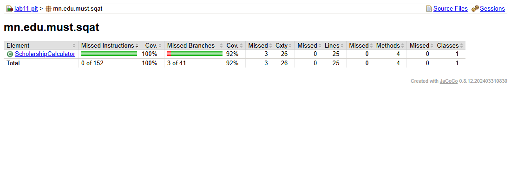
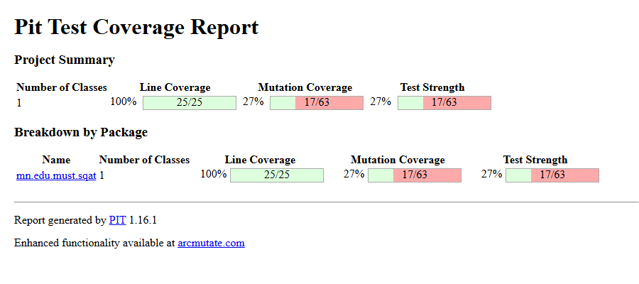

# Лаборатори №11: Mutation testing — PIT-ээр тестийн чанараа хэмжих

**Оюутан:** Х.Түмэн-Амгалан
**Код:** B232270063
**Хичээл:** F.CSA313 — Программ хангамжийн чанарын баталгаа ба тест (2026)

## Орчин

```
$ java -version
openjdk version "17.0.20.1" 2026-08-18
OpenJDK Runtime Environment Temurin-17.0.20.1+1 (build 17.0.20.1+1)
OpenJDK 64-Bit Server VM Temurin-17.0.20.1+1 (build 17.0.20.1+1, mixed mode, sharing)

$ mvn -version
Apache Maven 3.9.9 (8e8579a9e76f7d015ee5ec7bfcdc97d260186937)
Maven home: C:\Users\tumee\tools\apache-maven-3.9.9
Java version: 17.0.20.1, vendor: Eclipse Adoptium, runtime: C:\Program Files\Eclipse Adoptium\jdk-17.0.20.101-hotspot
Default locale: en_US, platform encoding: Cp1252
OS name: "windows 11", version: "10.0", arch: "amd64", family: "windows"
```

> Эх сурвалж: [`results/versions.txt`](results/versions.txt). PIT 1.16.1 (`STRONGER` операторууд),
> JaCoCo 0.8.12 — starter-ийн `pom.xml`. `src/main` нь лабын турш **өөрчлөгдөөгүй** (Starter commit-той
> ижил) — зөвхөн тестийг өөрчилсөн. `results/` дахь файлууд Git Bash-ийн `tee`-ээр UTF-8 текст.

## Эхний хэмжилт

```bash
mvn clean verify 2>&1 | tee results/mvn-verify-start.txt
cp target/site/jacoco/jacoco.csv results/jacoco-start.csv
mvn test-compile org.pitest:pitest-maven:mutationCoverage 2>&1 | tee results/pit-start.txt
```

**JaCoCo:** `results/jacoco-start.csv` — `LINE_MISSED 0, LINE_COVERED 25` → **Line 100% (25/25)**,
`BRANCH_MISSED 3, BRANCH_COVERED 38` → **Branch 38/41**.



**PIT:** `>> Generated 63 mutations Killed 17 (27%)`.



**Ажиглалт:** Line Coverage 100% байхад Mutation Coverage ердөө 27% байсан нь тестүүд кодын бүх мөрийг
**ажиллуулдаг** ч гаралтыг бараг **шалгадаггүй**-г хэлж байна. `assertNotNull(letterGrade(95))`,
`assertTrue(0 <= gpa <= 4)` гэх мэт assertion нь "A"-ийн оронд "" эсвэл 3.5-ийн оронд 0.0 буцаасан
буруу кодыг ч зөв гэж хүлээн авдаг тул 63 мутантын 46 нь амьд үлдсэн. Хамралт нь "код ажилласан уу"
гэдгийг, mutation score нь "буруу код байвал тест мэдэх үү" гэдгийг хэмждэг.

---

## Хэсэг A: Амьд мутантуудын ангилал (эхлэл дээр 46)

PIT-ийн XML тайлангаас (`mutations.xml`) мутант бүрийн мөр, оператор, тайлбарыг гаргасан.
Ижил шалтгаантайг нэг мөрөнд нэгтгэв. "Арга хэмжээ" багана нь B1 (assertion) / B2 (зааг) төлөвлөгөө.

| Мөр | Мутаци (PIT-ийн тайлбар) | Тоо | Ангилал | Арга хэмжээ (төлөвлөгөө) |
|---|---|---:|---|---|
| 20 | changed conditional boundary (`score < 0` → `<= 0`, `score > 100` → `>= 100`) | 2 | Тест дутуу | **B2**: `letterGrade(0)="F"`, `letterGrade(100)="A"` — заагийн яг утга |
| 23–26 | changed conditional boundary (`>= 90/80/70/60` → `>`) | 4 | Тест дутуу | **B2**: 90, 80, 70, 60 дээрх яг утга |
| 23–27 | replaced return value with "" (`letterGrade`) | 5 | Тест дутуу | **B1**: `assertNotNull` → `assertEquals("A"…"F")` |
| 23–26 | removed conditional — replaced comparison check with false / true | 8 | Тест дутуу | **B1**: яг үсгэн дүнг шалгахад салаа солигдсон нь илэрнэ |
| 36 | Changed switch default to be first case | 1 | Тест дутуу | **B1**: `gpa([40]) == 0.0` — F дүнгийн оноог яг шалгана |
| 38, 40 | Replaced double addition with subtraction (`total += 3`, `total += 1`) | 2 | Тест дутуу | **B1**: `gpa([95,85]) == 3.5`, `gpa([75,65]) == 1.5` |
| 44 | replaced double return with 0.0d (`gpa`) | 1 | Тест дутуу | **B1**: муж биш яг голч |
| 48 | changed conditional boundary (`gpa < 0`, `gpa > 4`) | 2 | Тест дутуу | **B2**: `scholarship(0.0, 0)`, `scholarship(4.0, 15)` хүчинтэй |
| 48 | removed conditional — replaced comparison check with true | 1 | Тест дутуу | **B2**: оролтын хязгаарын тест (gpa 0 / 4, credits 0) |
| 51 | removed conditional — replaced equality check with false / true (`hasViolation`) | 2 | Тест дутуу | **B1**: `scholarship(4.0, 20, true) == 0` ба зөрчилгүй тохиолдлын яг утга |
| 52–54 | replaced int return with 0 (`return 100/70/50`) | 3 | Тест дутуу | **B1**: `assertTrue(0..100)` → яг 100 / 70 / 50 |
| 52, 53 | removed conditional — replaced comparison check with false | 4 | Тест дутуу | **B1**: салаа алгасвал буцаах хувь өөрчлөгдөнө — яг утга шалгана |
| 52, 53 | changed conditional boundary (`>= 3.8`, `>= 15`, `>= 3.4`, `>= 12`) | 4 | Тест дутуу | **B2**: 3.8/15, 3.4/12 дээрх яг утга |
| 52, 53 | removed conditional — replaced comparison check with true (`&&`-ийн нэг тал) | 4 | Тест дутуу | **B2**: нэг тал хангагдаж нөгөө нь үгүй — (3.79,15), (3.8,14), (3.39,12), (3.4,11) |
| 54 | changed conditional boundary (`>= 3.0`) | 1 | Тест дутуу | **B2**: `scholarship(3.0,0)=50`, `(2.99,0)=0` |
| 54 | removed conditional — replaced comparison check with false / true | 2 | Тест дутуу | **B1**: 3.1 → 50 ба 2.0 → 0-ийг яг шалгана |
| | **Нийт** | **46** | **46 тест дутуу, 0 equivalent (одоогоор)** | B1 — 28, B2 — 18 (төлөвлөгөө) |

**Ангиллын үндэслэл:**
- **"changed conditional boundary"** (13): `>=`-ийг `>` болгох нь зөвхөн заагийн яг утга (90, 60, 3.8, 15 г.м.)
  дээр зан төлөвийг өөрчилдөг тул **тест дутуу** — starter-т заагийн утга нэг ч байгаагүй.
- **"replaced return value" / "replaced … with 0" / "addition with subtraction"** (11): гаралтын утгыг өөрчилдөг
  тул бодит зан төлөв өөрчлөгдөнө — **тест дутуу** (assertion сул байсан).
- **"Changed switch default to be first case"** (1): F дүнгийн оноог өөрчилдөг тул **тест дутуу** (доор).
- **"removed conditional"** (21): салааг үргэлж/хэзээ ч авахгүй болгох нь өөр үр дүн буцаадаг тул **тест дутуу**;
  `&&`-ийн нэг талыг "true" болгосон 4 мутант зөвхөн тэр тал **худал**, нөгөө нь **үнэн** үед ялгардаг.
- **Equivalent: одоогоор 0.** L36-ийн `switch` мутант equivalent байж магадгүй (String `switch` нь hash-аар
  хоёр шатлан хөрвүүлэгддэг) гэж сэжиглэж байгаа ч, зааврын «ихэнх нь үнэндээ тест дутуу» гэснийг
  харгалзан эхлээд B1-д F дүнгийн оноог яг шалгаж үзнэ; алагдахгүй бол equivalent гэж үндэслэнэ.
